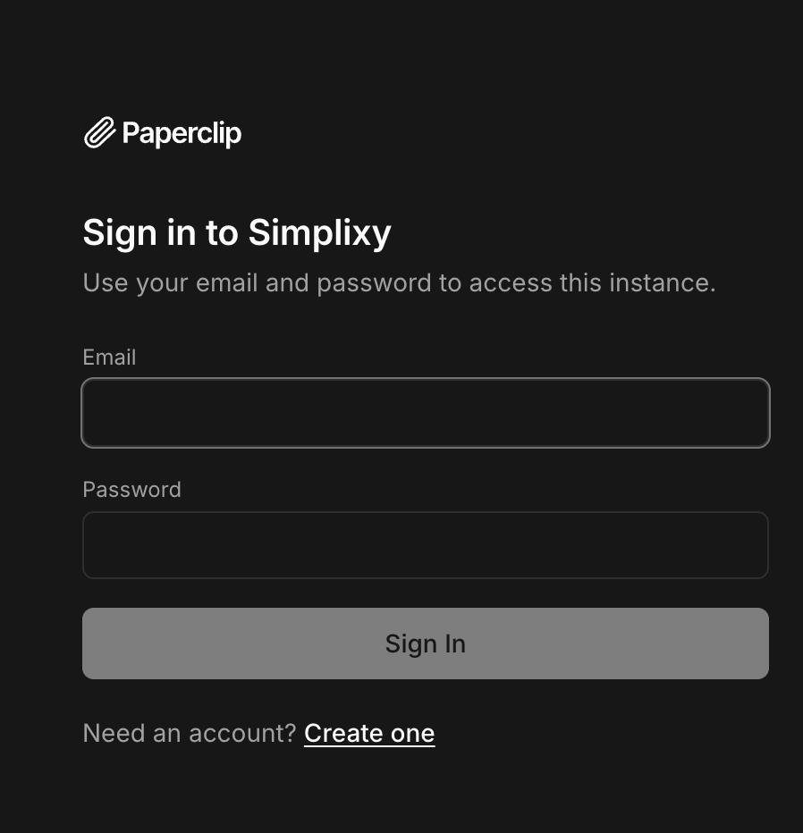

<p align="center">
  
</p>

# Simplexy

**AI Business Operations Assistant** — orkestrasi AI agent untuk operasional bisnis melalui percakapan.

> Built on top of [Paperclip](https://github.com/paperclipai/paperclip) (MIT License). Simplexy adalah fork komersial yang diadaptasi untuk kebutuhan operasional UMKM dan tim kecil.

---

## Apa itu Simplexy?

Simplexy membantu bisnis mengelola pekerjaan operasional melalui percakapan — mulai dari cek stok, pencatatan pesanan, hingga laporan harian — langsung dari WhatsApp, tanpa perlu membuka spreadsheet atau aplikasi terpisah.

```
WhatsApp → AI Agent → Google Sheets / Data Bisnis → Jawaban
```

### Kemampuan inti

- **Baca data bisnis** — cek stok, status pesanan, ringkasan
- **Catat & perbarui data** — pencatatan baru, update status, koreksi nilai
- **Laporan terjadwal** — ringkasan harian dikirim otomatis ke WhatsApp
- **Action gating** — setiap aksi tulis minta konfirmasi sebelum dieksekusi
- **Multi-tenant** — satu deployment untuk banyak pelanggan, data terisolasi

---

## Arsitektur

Simplexy mewarisi seluruh control plane Paperclip:

| Layer | Komponen |
|---|---|
| Backend | Node.js + Express |
| Database | PostgreSQL + drizzle-orm (embedded PGlite untuk dev) |
| Frontend | React + Vite |
| Runtime | Adapter-based (Claude, Codex, HTTP agent) |
| Integrasi | MCP connector framework (Google Sheets, Calendar, dll) |
| Plugin | Plugin SDK — extensible per use case |

---

## Quickstart (Development)

```sh
# Clone
git clone https://github.com/AndryanZulfi/simplexy.git
cd simplexy

# Install dependencies
pnpm install

# Run dev server (embedded DB, tidak perlu PostgreSQL)
pnpm dev
```

- API: `http://localhost:3100`
- UI: `http://localhost:3100`
- Health check: `curl http://localhost:3100/api/health`

Reset DB dev:
```sh
rm -rf data/pglite && pnpm dev
```

---

## Docker

```sh
docker compose -f docker/compose.yml up
```

Lihat `docker/` untuk konfigurasi production.

---

## Struktur Repo

```
server/          Express REST API + orchestration services
ui/              React board UI
packages/db/     Drizzle schema, migrations, DB clients
packages/shared/ Shared types, constants, validators
packages/adapters/ Agent adapter implementations
packages/google-sheets-mcp-server/ Google Sheets MCP integration
cli/             simplixy CLI
doc/             Docs teknis dan product specs
```

---

## Lisensi

Simplexy adalah fork dari [Paperclip](https://github.com/paperclipai/paperclip) yang dilisensikan di bawah **MIT License**.

Copyright (c) 2025 Paperclip AI — lihat [LICENSE](LICENSE) untuk teks lengkap.

Modifikasi dan tambahan untuk Simplexy: Copyright (c) 2026 Simplexy Team.
